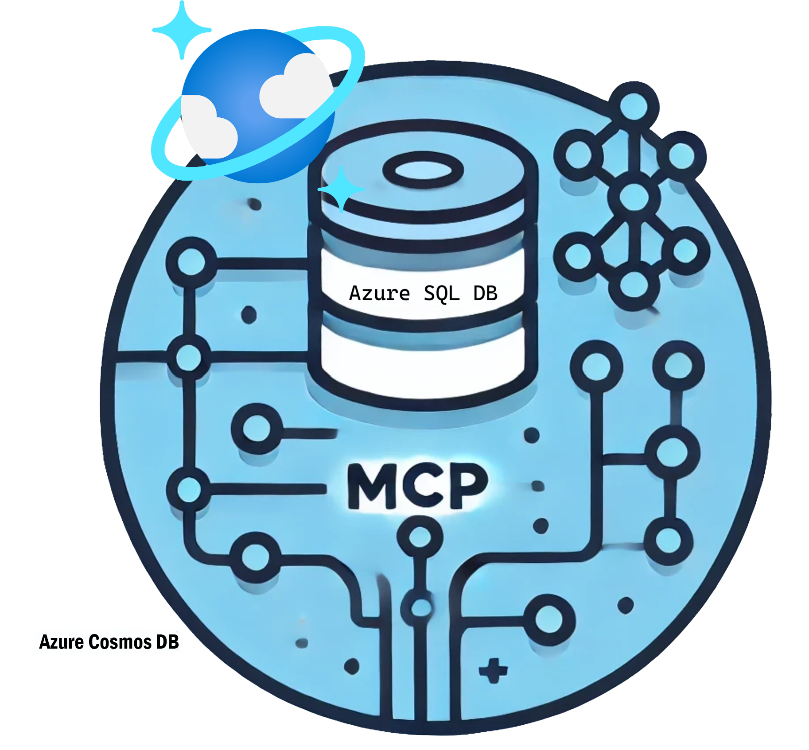

# MSSQL Database MCP Server

<div align="center">
  
</div>

> ⚠️ **EXPERIMENTAL USE ONLY** - This MCP Server is provided as an example for educational and experimental purposes only. It is NOT intended for production use. Please use appropriate security measures and thoroughly test before considering any kind of deployment.

## What is this? 🤔

This is a server that lets your LLMs (like Claude) talk directly to your MSSQL Database data! Think of it as a friendly translator that sits between your AI assistant and your database, making sure they can chat securely and efficiently.

### Quick Example

```text
You: "Show me all customers from New York"
Claude: *queries your MSSQL Database database and gives you the answer in plain English*
```

## How Does It Work? 🛠️

This server leverages the Model Context Protocol (MCP), a versatile framework that acts as a universal translator between AI models and databases. It supports multiple AI assistants including Claude Desktop and VS Code Agent.

### What Can It Do? 📊

- Run MSSQL Database queries by just asking questions in plain English
- Create, read, update, and delete data
- Manage database schema (tables, indexes)
- Secure connection handling
- Real-time data interaction

## Quick Start 🚀

### Prerequisites

- Node.js 14 or higher
- Claude Desktop or VS Code with Agent extension

### Set up project

1. **Install Dependencies**  
   Run the following command in the root folder to install all necessary dependencies:

   ```bash
   npm install
   ```

2. **Build the Project**  
   Compile the project by running:
   ```bash
   npm run build
   ```

## Configuration

The server uses a JSON config file instead of environment variables.

- **Default location:** `~/.mssql-mcp/config.json`
- **Override:** Set the `MSSQL_MCP_CONFIG` environment variable to point to your config file.

### Config file structure

```json
{
  "readonly": false,
  "connectionTimeout": 30,
  "servers": [
    { "name": "SQL2019", "host": "localhost", "port": 50075, "user": "sa", "password": "your-password" },
    { "name": "SQLPROD", "host": "prodserver", "instance": "SQLEXPRESS", "user": "sa", "password": "your-password" }
  ]
}
```

- **servers:** Array of server entries. Each needs `name`, `user`, `password`, and either `host`/`port` or `instance`.
- **readonly:** (Optional) When `true`, restricts all tools to read-only operations.
- **connectionTimeout:** (Optional) Connection timeout in seconds. Defaults to `30`.

Use `mcp-config.sample.json` in this folder as a starting point.

### Migration from env-based config

The old `HOST`, `PORT`, `USER`, `PASSWORD`, `DATABASE_NAME` environment variables are no longer supported. Create a config file and point to it with `MSSQL_MCP_CONFIG` (or use the default location `~/.mssql-mcp/config.json`).

## MCP Client Setup

### Option 1: VS Code Agent

1. Create a `.vscode/mcp.json` file or edit User Settings → MCP
2. Add:

```json
{
  "mcp": {
    "servers": {
      "mssql-nodejs": {
        "type": "stdio",
        "command": "node",
        "args": ["path/to/MssqlMcp/Node/dist/index.js"],
        "env": {
          "MSSQL_MCP_CONFIG": "/path/to/.mssql-mcp/config.json"
        }
      }
    }
  }
}
```

3. Restart VS Code. Run "MCP: List Servers" to verify.

### Option 2: Claude Desktop

1. File → Settings → Developer → Edit Config
2. Add:

```json
{
  "mcpServers": {
    "mssql": {
      "command": "node",
      "args": ["path/to/MssqlMcp/Node/dist/index.js"],
      "env": {
        "MSSQL_MCP_CONFIG": "/path/to/.mssql-mcp/config.json"
      }
    }
  }
}
```

3. Restart Claude Desktop.

Sample files: `src/samples/claude_desktop_config.json`, `src/samples/vscode_agent_config.json`.

## Tools

### list_databases

Lists all available databases across configured servers with enriched metadata.

- **Parameters (all optional):** `environment`, `application`, `client` — case-insensitive filters.
- **Metadata:** Database names matching `ENV_APP_CLIENT_suffix` are parsed into `environment`, `application`, `client`, and `suffix`. Names with fewer than three underscore-separated parts have `null` for those fields.

### database parameter

All tools accept an optional `database` parameter. If omitted, the last selected database is used. Call `list_databases` first to discover databases, then specify one when needed.

## Usage Examples

- "Show me all users from New York"
- "Create a new table called products with columns for id, name, and price"
- "Update all pending orders to completed status"
- "List all tables in the database"

## Security Notes

- The server requires a WHERE clause for read operations to prevent accidental full table scans
- Update operations require explicit WHERE clauses for security
- Set `readonly: true` in your config file for read-only access
